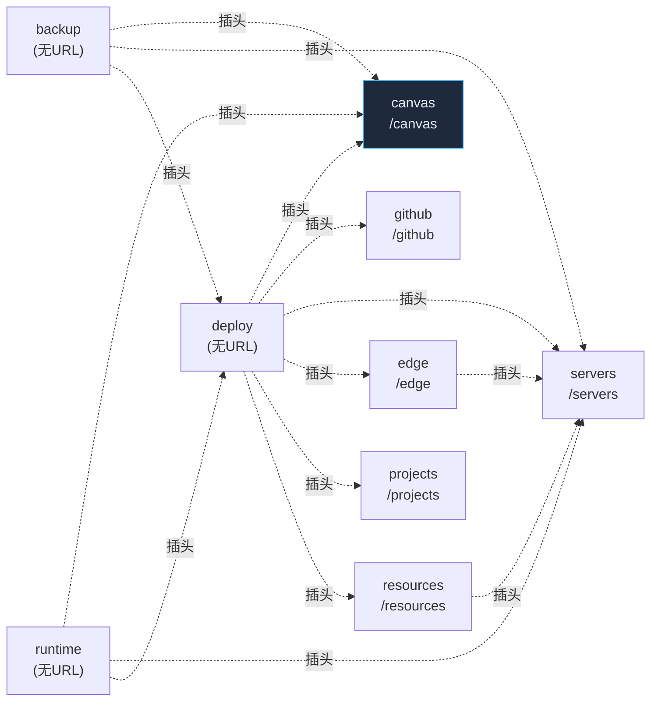

<!-- 由 scripts/atoms-mcp.ts --emit 生成，勿手改 -->

# elysiax 原子插座目录

## canvas  /canvas  `apps/dockyard/src/pages/canvas`
- 插座出口: 
  - `export { canvasNodes, serviceGroups } from "./schema"`
  - `export type { CanvasNode, ServiceGroup } from "./schema"`
  - `export { CanvasService } from "./canvas.service"`
  - `export type CanvasApi = typeof canvasApi`
- 插头（依赖的他人 socket）: 无
- 文件: canvas.di.ts, canvas.socket.ts, schema.ts, canvas.repository.ts, canvas.service.ts, canvas.model.ts, canvas.actions.ts, migrations.ts

## deploy  (无 URL)  `apps/dockyard/src/pages/deploy`
- 插座出口: 
  - `export { deployTargets, deployments } from "./schema"`
  - `export type { DeployTarget, Deployment, TargetService, TargetServicesDoc, DepEdge } from "./schema"`
  - `export { DeployService } from "./deploy.service"`
  - `export type { DbRef } from "./deploy.service"`
  - `export { events, CANVAS_CHANNEL } from "./events"`
  - `export type { CanvasEvent } from "./events"`
  - `export { ContainerPoller } from "./container-poller"`
  - `export { UpdatePoller } from "./update-poller"`
  - `export { detectRepo, detectLocal, detectToEnvText, detectToOverrideCompose, guessDbType } from "./detect"`
  - `export type { DetectResult, DetectedService } from "./detect"`
  - `export type DeployApi = typeof deployApi`
- 插头（依赖的他人 socket）: `../canvas/canvas.socket`, `../github/github.socket`, `../servers/servers.socket`, `../edge/edge.socket`, `../projects/projects.socket`, `../resources/resources.socket`
- 文件: deploy.di.ts, detect.ts, update-poller.ts, events.ts, deploy.socket.ts, schema.ts, migrations.ts, deploy.repository.ts, deploy.service.ts, container-poller.ts, deploy.actions.ts

## backup  (无 URL)  `apps/dockyard/src/pages/deploy/backup`
- 插座出口: 
  - `export { BackupService } from "./backup.service"`
- 插头（依赖的他人 socket）: `../../canvas/canvas.socket`, `../../servers/servers.socket`, `../deploy.socket`
- 文件: backup.service.ts, backup.di.ts, backup.socket.ts

## runtime  (无 URL)  `apps/dockyard/src/pages/deploy/runtime`
- 插座出口: 
  - `export { RuntimeService } from "./runtime.service"`
- 插头（依赖的他人 socket）: `../../canvas/canvas.socket`, `../../servers/servers.socket`, `../deploy.socket`
- 文件: runtime.service.ts, runtime.di.ts, runtime.socket.ts

## edge  /edge  `apps/dockyard/src/pages/edge`
- 插座出口: 
  - `export { domains } from "./schema"`
  - `export type { Domain } from "./schema"`
  - `export { EdgeService } from "./edge.service"`
- 插头（依赖的他人 socket）: `../servers/servers.socket`
- 文件: edge.socket.ts, edge.di.ts, edge.repository.ts, edge.service.ts, migrations.ts, schema.ts

## github  /github  `apps/dockyard/src/pages/github`
- 插座出口: 
  - `export { GithubService } from "./github.service"`
  - `export type { RepoBrief } from "./github.service"`
  - `export { parseOwnerRepo } from "./github"`
- 插头（依赖的他人 socket）: 无
- 文件: github.di.ts, github.service.ts, github.socket.ts, github.ts

## projects  /projects  `apps/dockyard/src/pages/projects`
- 插座出口: 
  - `export { projects } from "./schema"`
  - `export type { Project } from "./schema"`
  - `export { ProjectService } from "./projects.service"`
- 插头（依赖的他人 socket）: 无
- 文件: projects.di.ts, projects.page.tsx, schema.ts, migrations.ts, projects.socket.ts, config.ts, local.service.ts, projects.actions.tsx, projects.partials.tsx, projects.repository.ts, projects.service.ts

## resources  /resources  `apps/dockyard/src/pages/resources`
- 插座出口: 
  - `export { serverResources } from "./schema"`
  - `export type { ServerResource } from "./schema"`
  - `export { ResourceService } from "./resources.service"`
  - `export type { SharedEnv } from "./resources.service"`
  - `export {`
  - `export type { DbType } from "./db-templates"`
- 插头（依赖的他人 socket）: `../servers/servers.socket`
- 文件: resources.socket.ts, db-templates.ts, resources.di.ts, resources.repository.ts, resources.service.ts, schema.ts, migrations.ts

## servers  /servers  `apps/dockyard/src/pages/servers`
- 插座出口: 
  - `export { servers } from "./schema"`
  - `export type { Server } from "./schema"`
  - `export { ServerService } from "./servers.service"`
- 插头（依赖的他人 socket）: 无
- 文件: docker-relay.ts, servers.di.ts, servers.page.tsx, schema.ts, migrations.ts, servers.socket.ts, servers.actions.tsx, servers.partials.tsx, servers.repository.ts, servers.service.ts, ssh-pool.ts
